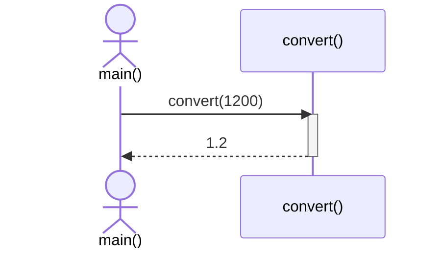

# Функции и контракты

> ID: T1-M1-L3 · Тип: урок

## Цель и критерий освоения

Ты формулируешь предусловия и постусловия, выбираешь способ передачи параметров и не возвращаешь ссылки с недостаточным временем жизни.

## Теория

У функции должен быть ясный контракт. Предусловия описывают, что вызывающий код обязан обеспечить. Постусловия описывают результат успешного вызова. Если операция может отказать, способ отказа также должен быть определён. Это может быть исключение, `std::optional`, `std::expected` в подходящем стандарте или код ошибки.

Передача по значению удобна для небольших типов и когда нужна собственная копия. `const T&` позволяет читать крупный объект без копирования, но объект должен жить во время вызова. `T&` означает, что функция может изменить исходный объект. Возвращать ссылку можно только на объект, который переживёт вызов.

Разделяй функции по ответственности. Парсер должен разбирать данные, а не сам открывать файлы, писать в базу и печатать логи. Тогда его проще проверять независимыми тестами.

### Последовательность вызова



Диаграмма показывает вызов и возврат значения. Она не претендует на описание реального машинного стека.

## Разобранный пример

```cpp
#include <optional>
#include <vector>

std::optional<std::size_t> find_index(
    const std::vector<int>& values, int target)
{
    for (std::size_t i = 0; i < values.size(); ++i) {
        if (values[i] == target) return i;
    }
    return std::nullopt;
}
```

Контракт возвращает индекс первого совпадения или `nullopt`. Индекс `0` — корректный результат и не может служить признаком ошибки.

## Практика

1. **Задача:** Определи поведение функции деления при нулевом знаменателе.
   - **Критерий проверки:** Ошибка задана явно и покрыта тестом.
   - **Подсказка:** Не возвращай произвольный ноль как будто это корректный ответ.

2. **Задача:** Напиши поиск, возвращающий позицию или отсутствие результата.
   - **Критерий проверки:** Первый элемент не путается с отсутствием совпадения.
   - **Подсказка:** Используй `std::optional`.

3. **Задача:** Раздели чтение файла и разбор строки на разные функции.
   - **Критерий проверки:** Парсер тестируется без файловой системы.
   - **Подсказка:** Передавай парсеру строку, а не имя файла.

## Граничные случаи

- Возврат ссылки на локальный объект; неоднозначная перегрузка; глубокая рекурсия.

## Типичные ошибки

- Возвращать ссылку на локальную переменную.
- Использовать магическое значение, которое может быть настоящим результатом.
- Смешивать ввод-вывод и бизнес-логику без необходимости.

## Контрольные вопросы

1. Чем предусловие функции отличается от постусловия?
2. Когда параметр стоит передать по значению, а когда по const-ссылке?
3. Почему нельзя возвращать ссылку на локальную переменную?
