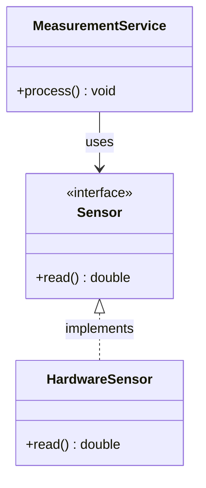

# Проектирование классов: композиция, интерфейсы и инварианты

> ID: T3-M2-L1 · Тип: урок

## Цель и критерий освоения

Ты умеешь выбрать композицию или наследование исходя из контракта и проектировать класс с защищённым инвариантом.

## Теория

Класс должен защищать инварианты своего состояния. Если объект описывает диапазон, конструктор не должен позволять создать недопустимый порядок границ, если это запрещено контрактом. Чем больше некорректных состояний объект допускает, тем больше проверок потребуется в остальной системе.

Композиция означает, что объект использует другие объекты как части поведения. Наследование подходит, когда существует корректное отношение подстановки. Производный объект должен работать там, где ожидают базовый, без нарушения его контракта. Если удаление через базовый указатель допустимо, базовому классу обычно нужен виртуальный деструктор.

Полиморфизм во время выполнения полезен, когда реализация выбирается по реальному типу объекта. Если тип известен при компиляции, шаблоны могут быть проще. Не вводи интерфейс только ради паттерна. Вводи его ради нужной заменяемости, изоляции теста или границы модуля.

### UML: границы и зависимости



Здесь показаны зависимость сервиса от контракта и реализация этого контракта аппаратным адаптером. Стрелка зависимости не означает автоматически владение памятью: время жизни объектов задаётся отдельно в C++-коде.

## Разобранный пример

```cpp
#include <memory>
#include <string>

struct Device {
    virtual ~Device() = default;
    virtual std::string name() const = 0;
};

struct Radio final : Device {
    std::string name() const override { return "radio"; }
};

int main() {
    std::unique_ptr<Device> device = std::make_unique<Radio>();
}
```

Виртуальный деструктор позволяет корректно уничтожить `Radio` через `Device`. Интерфейс должен дополнительно описывать контракт `name()`.
## Практика

1. **Задача:** Спроектируй набор устройств через композицию и интерфейс.
   - **Критерий проверки:** Добавление реализации не требует переписывать каждую ветвь клиента.
   - **Подсказка:** Динамический полиморфизм нужен, только если реализация выбирается во время выполнения.

2. **Задача:** Найди пример нарушения принципа подстановки.
   - **Критерий проверки:** Определено, какой контракт базового класса нарушает производный тип.
   - **Подсказка:** Сравни предусловия и постусловия.

3. **Задача:** Добавь инвариант в класс диапазона.
   - **Критерий проверки:** Все публичные операции сохраняют корректное состояние.
   - **Подсказка:** Проверка в единственном вызывающем месте не обеспечивает инвариант класса.

## Граничные случаи

- Срезка объекта; virtual-вызов в конструкторе; удаление через базовый указатель.

## Типичные ошибки

- Удалять производный объект через базовый указатель без виртуального деструктора.
- Наследоваться ради небольшого повторения кода.
- Оставлять публичные методы, нарушающие инварианты.

## Контрольные вопросы

1. Когда отношение между типами следует моделировать композицией, а не наследованием?
2. Как инвариант класса защищается приватными полями и публичными методами?
3. Почему зависимость на абстракцию облегчает тестирование по сравнению с зависимостью на конкретный класс?
